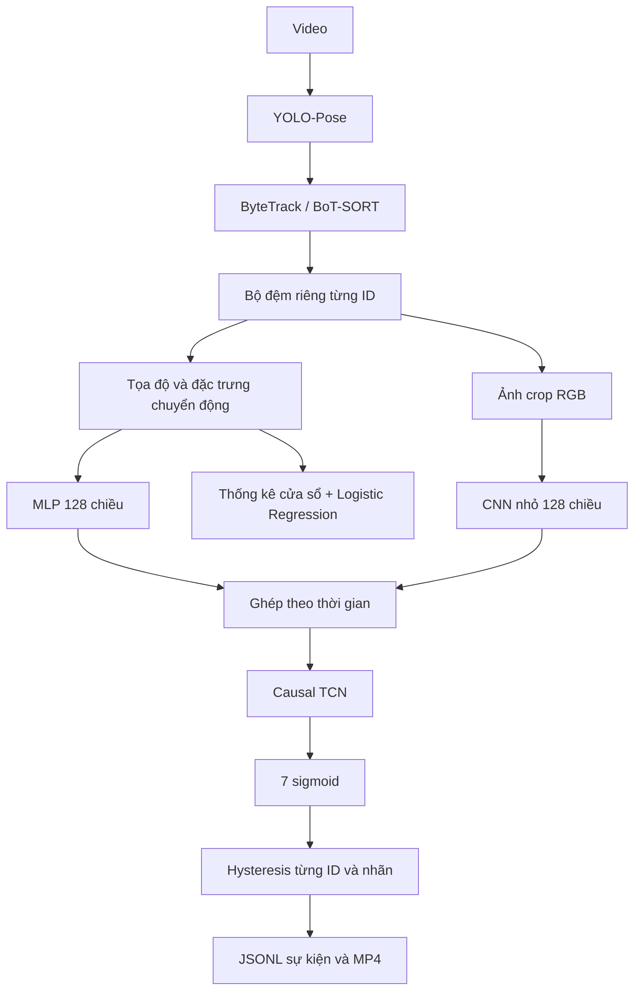

# MotionGuard — YOLO-Pose + tracking + temporal multilabel recognition

Project Python cho video có một hoặc nhiều người. Có hai tuyến học: baseline đặc trưng chuyển động + Logistic Regression, và causal TCN, có thể thêm nhánh CNN ảnh crop. Đây là mã nghiên cứu có CLI và kiểm thử, chưa có trọng số hành vi được kiểm chứng trên người thật.

**YOLO pretrained chỉ nhận người/keypoint, không nhận sẵn 7 hành vi.** Bạn phải cung cấp video gán nhãn để huấn luyện bộ phân loại hành vi. Các điểm sigmoid không phải độ tin cậy chẩn đoán lâm sàng.

## 1. Cài đặt (Windows PowerShell)

Khuyến nghị Python 3.11 hoặc 3.12. Python 3.14 chưa thuộc phạm vi khai báo hỗ trợ.

```powershell
cd motionguard
py -3.11 -m venv .venv
.\.venv\Scripts\Activate.ps1
python -m pip install --upgrade pip
python -m pip install -e ".[video,tcn,dev]"
python -m motionguard --help
```

Nếu PowerShell chặn activate, dùng trực tiếp `.\.venv\Scripts\python.exe` thay cho `python` ở các lệnh. Linux/macOS: `python3 -m venv .venv`, `source .venv/bin/activate`, rồi cùng các lệnh pip.

- Chỉ baseline/demo: `python -m pip install -e .`.
- Chạy GPU: cài PyTorch tương thích driver/GPU từ hướng dẫn PyTorch, rồi đổi `device: cuda:0` trong YAML và dùng `--device cuda:0` khi suy luận. Không có cam kết FPS trước khi đo.
- YOLO mặc định `yolo11n-pose.pt`, tải tự động lần chạy đầu nếu máy có Internet. Có thể đặt đường dẫn checkpoint local; phải xuất đúng COCO 17 keypoint.
- Các range dependency trong pyproject chưa phải lockfile; sau khi cài thành công trên máy, lưu môi trường bằng `python -m pip freeze > environment-lock.txt`.

## 2. Chạy demo không cần video hoặc tải YOLO

```powershell
python -m motionguard demo --out runs/demo
```

Lệnh tạo feature giả, chia train/val/test độc lập, huấn luyện baseline và đánh giá. Kết quả chỉ xác nhận pipeline phần mềm, **không thể dùng để đánh giá độ chính xác hành vi hay y khoa**. Checkpoint `DEMO_ONLY_baseline.joblib` bị chặn ở lệnh suy luận video.

## 3. Kiến trúc thực hiện



Đặc trưng gồm tọa độ tương đối cơ thể và tọa độ ảnh, confidence, mask, tuổi khớp thiếu, vận tốc tương đối/toàn ảnh, gia tốc, góc khớp kèm mask, độ nghiêng, bất đối xứng hai bên, khoảng cách cổ tay–mũi/vai/hông, hình học bbox. Kích thước hiện tại là 288 đặc trưng/frame; checkpoint kiểm tra dimension. NPZ do extractor tạo có `schema_version` và `feature_config`; loader từ chối cấu hình feature khác khi huấn luyện/đánh giá.

TCN mặc định: 5 residual blocks, hai Conv1D causal/block, kernel 3, dilation 1/2/4/8/16, channels 128, dropout 0.1. Receptive field 125 bước (~8.3 giây ở 15 Hz); window 128. LayerNorm thực hiện theo channel **tại từng bước**, tránh phụ thuộc frame tương lai. Đầu ra từng bước `[B,T,7]`.

Nhánh ảnh hiện thực bằng CNN nhỏ 3 lớp stride 2, học từ dữ liệu dự án; không tự tải pretrained ImageNet. Cấu hình ảnh mặc định 96×96 để giảm RAM; có thể tăng trong YAML rồi trích xuất và huấn luyện lại. Đây là lựa chọn triển khai ban đầu, chưa phải khẳng định tối ưu hơn encoder pretrained.

## 4. Chuẩn bị video và trích xuất

```powershell
python -m motionguard extract --source data/raw/video01.mp4 --out data/extracted/video01 --config configs/default.yaml
```

Nếu dùng RGB:

```powershell
python -m motionguard extract --source data/raw/video01.mp4 --out data/extracted/video01 --config configs/rgb.yaml --save-crops
```

Output `person<ID>_segment<NNNN>.npz` chứa:

| Trường | Dạng | Ý nghĩa |
|---|---|---|
| features | N×F float32 | Đặc trưng chuyển động |
| timestamps | N | Giây từ đầu video; giữ thời gian gốc qua các segment |
| quality | N bool | Đủ điều kiện quan sát theo cấu hình |
| keypoints | N×17×3 | Keypoint gốc |
| bboxes | N×4 | Bbox gốc |
| person_id | scalar | ID tracker, không phải danh tính sinh học |
| crops | N×H×W×3 uint8 | RGB, chỉ khi `--save-crops` |

Segment được đóng khi người không được quan sát ở một bước lấy mẫu hoặc sau tối đa khoảng 60 giây để giới hạn RAM. Đánh giá/gán nhãn phải đối chiếu video để biết ID nào thuộc người nào; không tự xem hai ID tracker là hai người khác nhau. Mọi segment của cùng người hoặc cùng video phải ở cùng một split.

Trích xuất, huấn luyện và suy luận cần giữ cùng cấu hình feature, sampling, quality và crop; khi thay đổi, trích xuất lại. `extraction_config.json` lưu cấu hình tham chiếu. Góc và vận tốc là chiếu 2D, không phải đo đạc giải phẫu 3D.

## 5. Gán nhãn theo từng track

Sửa `examples/annotations.json` theo đoạn người đang xét. Thời gian là **thời gian video gốc**, khoảng `[start,end)`.

```powershell
python -m motionguard annotate --record data/extracted/video01/person1_segment0001.npz --annotations examples/annotations.json --out data/labeled/video01_person1_seg1.npz
```

`reviewed_labels` nghĩa là bạn đã kiểm tra toàn bộ record cho các nhãn đó: ngoài khoảng sự kiện sẽ được gán 0. Nhãn chưa được kiểm tra mặc định -1, bị loại khỏi loss/metrics, không bị coi là âm tính. Các khoảng giao nhau ở nhiều nhãn được phép.

| Nhãn | Diễn giải gán nhãn |
|---|---|
| fall | Chuyển tiếp ngã; phân biệt nằm chủ động và thời gian nằm sau ngã |
| stumble | Vấp/chao đảo/lấy lại thăng bằng |
| collapse_to_sit | Hạ thân đột ngột vào tư thế ngồi; phân biệt ngồi có chủ đích |
| cough_sneeze | Động tác quan sát phù hợp ho/hắt hơi, giữ chung một lớp |
| holding_suspected_pain_area | Giữ một vùng cơ thể theo quy ước; không xác nhận có đau |
| vomit_like | Động tác giống nôn/ói |
| seizure_like | Chuyển động giống co giật theo quy ước quan sát |

Không có head normal riêng. `normal` là không có sự kiện/candidate khi đủ dữ liệu. `insufficient_data` dùng khi người quá nhỏ, mất khớp hoặc chưa đủ history. `candidate` là đang chờ đủ thời gian xác nhận.

17 COCO keypoint không biểu diễn chi tiết ngón tay/miệng. Cần đánh giá riêng nhóm ho/hắt hơi, giữ vùng nghi đau và giống nôn; có thể cần video rõ hơn, landmark tay/mặt hay dữ liệu bổ sung. Không dùng các nhãn này để suy ra bệnh.

## 6. Manifest và chống rò rỉ

Sao chép `examples/manifest.jsonl`, mỗi dòng là một NPZ đã gán nhãn:

```json
{"path":"../data/labeled/video01_person1_seg1.npz","split":"train","subject_id":"P001","source_id":"video01"}
```

Path tương đối với vị trí manifest. `subject_id` là danh tính người do người quản lý dữ liệu gán; `source_id` là video/session gốc. Chương trình từ chối khi cùng subject/source/path xuất hiện ở các split khác nhau. Nếu nhiều người cùng video, các video có chung người có thể tạo thành một nhóm liên thông cần chia chung. Tự tạo đủ train, val, test; mỗi nhãn cần mẫu dương và âm đã được kiểm tra trong train và val.

Không chia ngẫu nhiên cửa sổ trước rồi coi là ba tập độc lập. Thêm hard negatives: ngồi nhanh, cúi nhặt đồ, nằm chủ động, uống nước, che miệng, gãi, nhảy/múa, tập thể dục.

## 7. Huấn luyện

Không cần chỉ định nơi lưu. Hai lệnh sau tự tạo thư mục riêng cho mỗi lần chạy trong `runs/` của thư mục làm việc hiện tại:

```powershell
python -m motionguard train-baseline --manifest examples/manifest.jsonl --config configs/default.yaml
python -m motionguard train-tcn --manifest examples/manifest.jsonl --config configs/default.yaml
```

Ví dụ checkpoint: `runs/tcn/20261028_083000_ab12cd34/model.pt` hoặc `runs/baseline/20261028_083000_ab12cd34/model.joblib`. Timestamp theo giờ máy chạy; hậu tố ngẫu nhiên tránh trùng ngay cả khi chạy cùng giây. Báo cáo `model.validation.json` lưu cùng thư mục. Terminal in đường dẫn đầy đủ trước huấn luyện và khi lưu thành công. Nếu muốn đường dẫn cụ thể, vẫn dùng `--out` như các ví dụ dưới.

Tự chọn đường dẫn không thay đổi thời điểm lưu: checkpoint vẫn được ghi khi huấn luyện hoàn tất; bản này chưa tự lưu từng epoch hoặc hỗ trợ resume.

```powershell
python -m motionguard train-baseline --manifest examples/manifest.jsonl --out runs/baseline.joblib --config configs/default.yaml
python -m motionguard train-tcn --manifest examples/manifest.jsonl --out runs/tcn.pt --config configs/default.yaml
```

TCN + RGB dùng manifest chứa crops và `--config configs/rgb.yaml`. Batch mặc định RGB nhỏ hơn nhưng RAM/VRAM tăng theo số frame và crop. Nếu hết bộ nhớ, giảm `batch_size`, `crop_size` hoặc dùng pose-only trước; chưa có benchmark VRAM được đo.

- Baseline: mean/std/min/max/Q1/Q3/slope theo cửa sổ, scaler + 7 Logistic Regression cân bằng lớp.
- TCN: scaler fit chỉ trên raw frame train; masked weighted BCE, AdamW, gradient clipping. Checkpoint chọn theo validation loss.
- Hai tuyến dùng ngưỡng từng nhãn tối ưu F1 trên validation. Đây là heuristic khởi đầu; nên chọn theo ngân sách báo giả/giờ và event recall của hệ thống thực tế.
- Hysteresis dùng threshold bật trong checkpoint, threshold tắt thấp hơn; `confirm_sec` và `release_sec` vẫn theo config lúc train.
- Cửa sổ không vượt qua frame kém chất lượng hoặc khoảng mất dấu dài. Padding trái bằng 0 trong không gian đã chuẩn hóa.
- Checkpoint `.pt` và `.joblib` dùng serialization Python: chỉ nạp file do bạn tạo hoặc tin cậy.

## 8. Đánh giá

```powershell
python -m motionguard evaluate --manifest examples/manifest.jsonl --checkpoint runs/baseline.joblib --out runs/baseline_test.json
python -m motionguard evaluate --manifest examples/manifest.jsonl --checkpoint runs/tcn.pt --out runs/tcn_test.json --device cpu
```

Báo cáo precision/recall/F1, AP (PR-AUC theo average precision), ROC-AUC và TP/FP/FN/TN từng nhãn. Đơn vị đánh giá là **điểm cuối cửa sổ lấy mẫu**, không phải từng sự kiện. Một lớp thiếu cả dương hoặc âm trong test có AUC null. Các metric này không thay cho event recall hay false alarms/hour.

Đánh giá sự kiện đã xuất:

```powershell
python -m motionguard evaluate-events --ground-truth data/gt_events.jsonl --predictions runs/video01/events.jsonl --reviewed-camera-hours 1.5 --iou 0.3 --out runs/event_metrics.json
```

GT JSONL cần `camera_id,person_id,label,start_time_sec,end_time_sec`. Gán/mapping `person_id` GT về ID tracker của run trước khi so. Bộ đánh giá ghép một-một theo temporal IoU, cùng camera/person/nhãn; xuất event precision/recall/F1, báo giả/camera-giờ và median detection delay. Chỉ dùng khi toàn bộ thời gian camera khai báo đã được review cho cả 7 nhãn. Không tự tính chất lượng tracking, hiệu chuẩn, FPS hay khoảng tin cậy; cần đo riêng trên bộ test thực.

## 9. Suy luận video/camera

```powershell
python -m motionguard infer --source data/raw/video01.mp4 --checkpoint runs/tcn.pt --out runs/video01 --device cpu --display
python -m motionguard infer --source 0 --checkpoint runs/tcn.pt --out runs/camera01 --camera-id cam01 --device cpu
```

Không cần YAML riêng khi infer: config feature/model lấy từ checkpoint. `--display` cần OpenCV GUI, bỏ flag ở máy headless. Nguồn có thể là file, chỉ số camera hoặc URL stream OpenCV hỗ trợ.

Output:

- `scores.jsonl`: ID, timestamp, trạng thái, quality, điểm từng nhãn mỗi bước đủ dữ liệu.
- `events.jsonl`: sự kiện đã đóng, thời điểm onset/detected/end, peak score, lý do kết thúc, đường dẫn clip và thông tin cắt ngắn.
- `event_*.mp4`: clip ngữ cảnh toàn khung camera, gồm người liên quan và có thể cả người khác. Không phải clip đã ẩn danh hay chỉ crop người.
- `run_config.json`: cấu hình và thứ tự nhãn.

Clip được mở ngay khi xác nhận sự kiện, lấy pre-roll từ ring buffer rồi ghi tiếp xuống đĩa. Giới hạn mặc định 30 giây/clip; sự kiện dài vẫn có metadata toàn sự kiện nhưng clip có `clip_capped=true`. Cuối stream có thể thiếu post-roll, được đánh dấu. Sự kiện đang diễn ra chưa có bản ghi hoàn tất trong `events.jsonl`; xem `scores.jsonl` để theo dõi trực tiếp. Tắt bằng Q khi display hoặc Ctrl+C để đóng writer và flush sự kiện.

## 10. Kiểm thử và giới hạn

```powershell
python -m pytest -q
```

Kiểm thử bao gồm mất khớp không tạo vận tốc giả, timestamp, đa nhãn/hysteresis, unknown labels, leakage theo subject, tính nhân quả TCN pose/RGB, backward, clip MP4 và video pipeline với YOLO adapter giả lập. Xem `docs/VALIDATION.md` để biết phần nào đã chạy trong môi trường tạo project. Có thể chạy lại tích hợp TCN bằng `python scripts/smoke_tcn.py` và `python scripts/smoke_tcn.py --rgb --out runs/tcn_rgb_smoke`.

Chưa có dataset thực, nên chưa báo độ chính xác, độ nhạy hay tốc độ real-time. FPS phụ thuộc YOLO, số người, crop CNN, thiết bị và giải mã video. Luồng trực tiếp dùng timestamp monotonic; khi xử lý chậm sẽ lấy ít bước hơn, cần đo dropped frames và đánh giá độ bền với tốc độ lấy mẫu. Online hiện tính lại cửa sổ TCN mỗi bước, chưa có cache convolution. Không có web dashboard hoặc dịch vụ multi-camera trong phiên bản CLI này.

## Cấu trúc

```text
motionguard/
  configs/                 # pose-only / RGB
  examples/                # annotation và manifest
  motionguard/
    config.py              # nhãn, cấu hình và kiểm tra
    features.py            # feature causal, mask và quality
    data.py                # annotation, manifest, window
    models.py              # CNN + causal TCN
    train.py               # train/evaluate/predictor
    events.py              # máy trạng thái theo ID/nhãn
    video.py               # YOLO, tracking, video I/O, clip
    event_metrics.py       # event IoU, báo giả và delay
    demo.py                # tín hiệu giả để smoke-test
    cli.py                 # lệnh chạy
  tests/
  docs/
  pyproject.toml
  requirements.txt
```

Tài liệu nền tảng: [Ultralytics Pose](https://docs.ultralytics.com/tasks/pose/), [Ultralytics Tracking](https://docs.ultralytics.com/modes/track/), [TCN paper](https://arxiv.org/abs/1803.01271). Kiểm tra điều khoản của dependency/weights trước khi phân phối ứng dụng; project không kèm dữ liệu người thật hoặc checkpoint hành vi thực.
